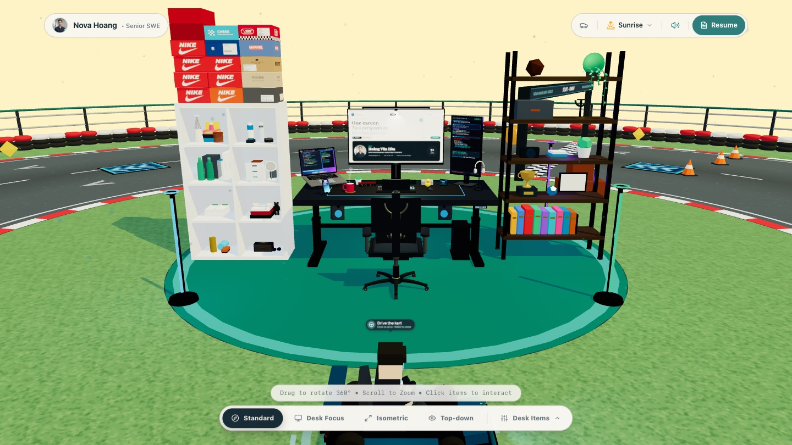
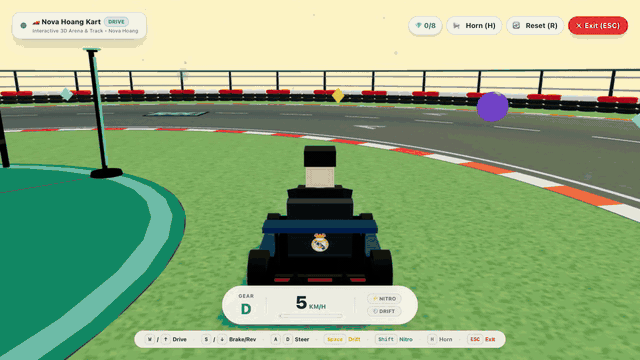
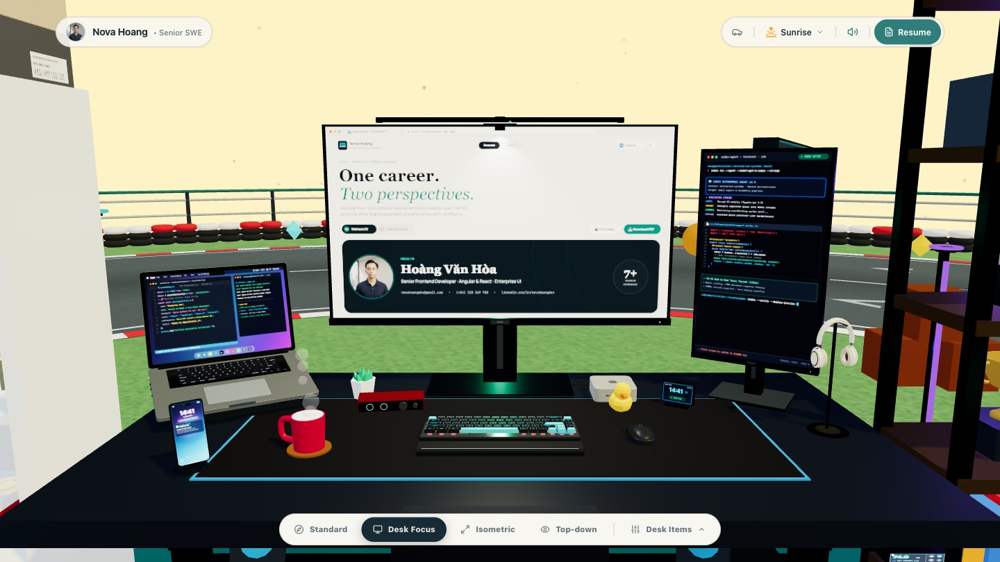
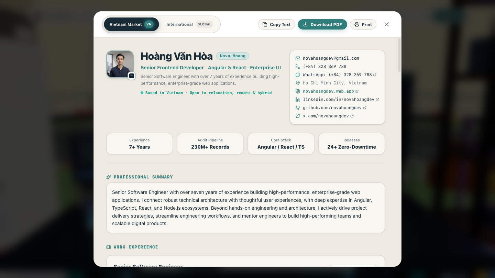

# interactive-workspace

[](https://github.com/novahoangdev/interactive-workspace/actions/workflows/firebase-hosting.yml)

An interactive 3D workspace showcasing my desk setup, profile, projects, and professional journey. Explore the desk, open the CV, or drive the kart around the circuit.

**Live demo:** https://interactive-workspace-nova.web.app



## Demo
### Drive the kart around the circuit


### Desk focus


### Interactive CV


## Features
- Explore the desk in 360°: drag to rotate, scroll to zoom, click items to interact.
- Camera presets (Standard, Desk Focus, Isometric, Top-down) and a Desk Items menu to jump to each item.
- Full CV in Vietnam and International versions, with copy, print and PDF download.
- Drivable kart with collisions, boost pads, a jump ramp, physics props and collectible gems.
- Four lighting themes (Sunrise, Daylight, Sunset, Night), sound effects and background music.

### Kart controls
| Key | Action |
|---|---|
| `W` / `↑` | Drive |
| `S` / `↓` | Brake / reverse |
| `A` / `D` | Steer |
| `Space` | Drift |
| `Shift` | Nitro |
| `H` | Horn |
| `R` | Reset |
| `Esc` | Exit |

## Tech stack
- React 19 + TypeScript
- Three.js (procedural models, no external 3D assets)
- Tailwind CSS v4
- Vite
- Web Audio API for sound effects and music

## Getting started
### Requirements
- [Bun](https://bun.sh)

### Install
```bash
bun install
```

### Development
```bash
bun run dev      # http://localhost:3000
```

## Commands
| Purpose | Command |
|---|---|
| Dev | `bun run dev` |
| Type check | `bun run lint` |
| Build | `bun run build` |
| Preview build | `bun run preview` |

## Deployment
Hosted on Firebase Hosting (project `interactive-workspace-nova`).

- Every push to `main` builds and deploys automatically via `.github/workflows/firebase-hosting.yml`.
- Manual deploy: `bun run build && firebase deploy --only hosting`.

## Project structure
```text
docs/media/        README screenshots and demo GIF
public/            static images, favicon, web manifest
src/
  components/      React overlays: HUD, CV modal, project modal, controls
  data/cvData.ts   profile and CV content
  three/           Three.js scene: workstation, circuit, kart, prop physics
  utils/           Web Audio sound manager
```

## Content
Profile and CV content lives in `src/data/cvData.ts` and must stay in sync with `PROFILE.md` in the [portfolio repo](https://github.com/novahoangdev/portfolio). The "Download PDF" button links to the reviewed CV PDFs published on novahoangdev.web.app.

## Documentation
- `AGENTS.md` — project agent rules
- `DECISIONS.md` — durable decisions
- `docs/architecture.md` — architecture
- `docs/design-system.md` — UI conventions
